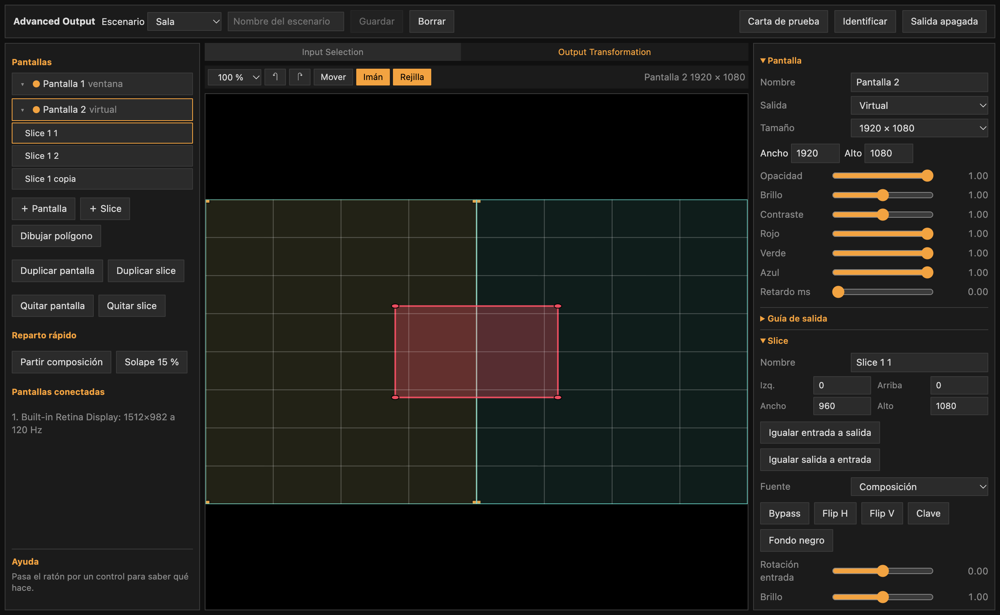
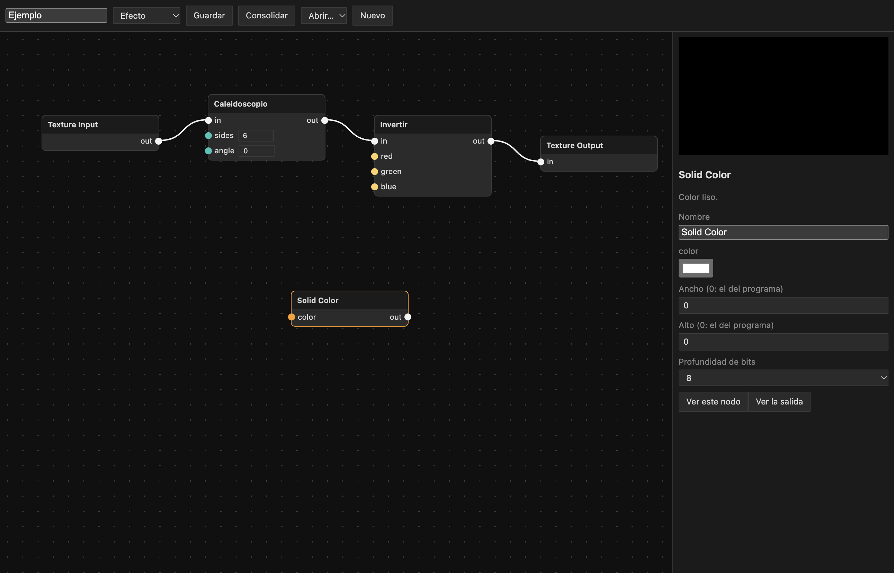
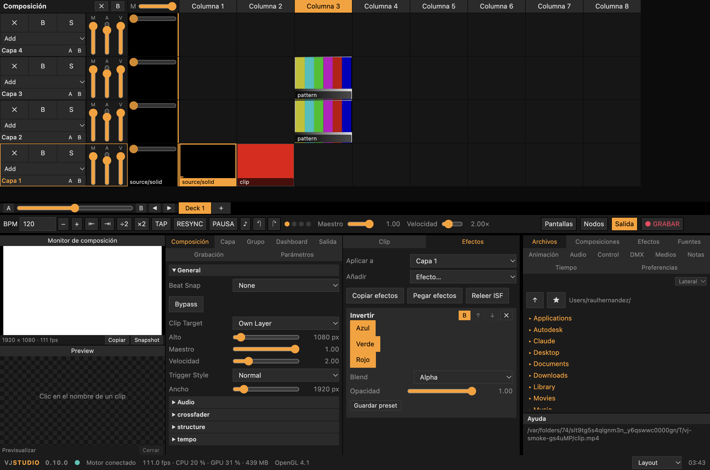
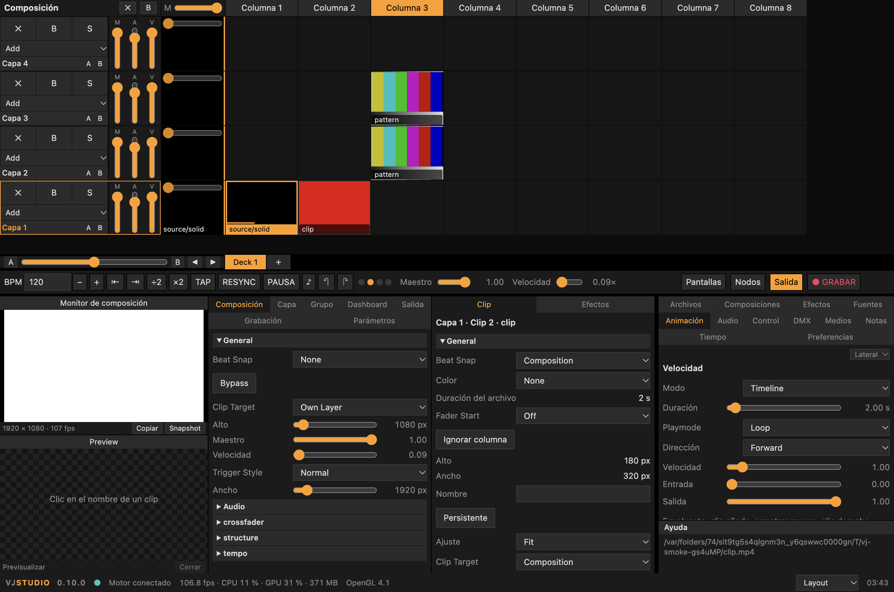
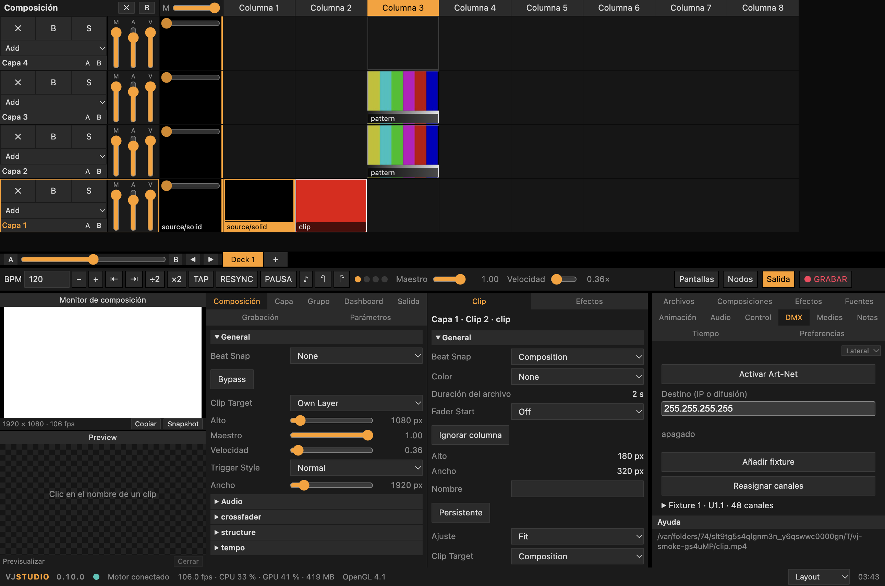
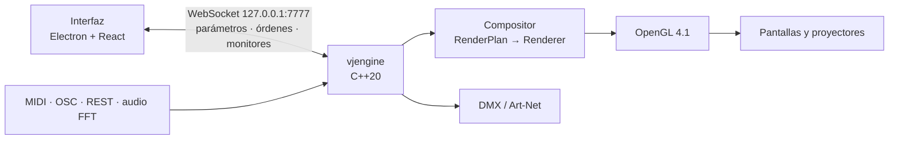

<div align="center">

# 🎛️ VJ Studio

**Software de VJ y mapeo de vídeo para directo: mezcla clips en tiempo real, aplica efectos, los sincroniza con la música y reparte la imagen entre varias pantallas, proyectores y luces DMX.**

Motor gráfico en C++20 y OpenGL 4.1 · interfaz en Electron y React · 27 suites de pruebas

[](https://github.com/raulhernandezherce/vj-studio/releases/latest)


</div>

---

## Qué hace

| | |
|---|---|
| 🎬 **Matriz de clips** | Capas y columnas (hasta 32 × 64) con disparo por clip o por columna, decks, grupos y crossfader A/B. Más de 100 fps a 1080p en un Mac con Apple Silicon. |
| ✨ **Efectos** | Catálogo de 57 efectos y fuentes, blend modes, LUT, shaders ISF y plugins **FFGL**. Los efectos se arrastran a las celdas. |
| 🎵 **Música** | Tempo con tap y resync, beat snap, análisis de audio por FFT y animación de cualquier parámetro sincronizada con el BPM. |
| 🖥️ **Pantallas** | Varias salidas con slices, máscaras, deformación por malla, edge blending para unir proyectores, retardo por pantalla y enrutado por bus del crossfader. |
| 🧩 **Editor de nodos** | Unos 90 nodos para crear efectos y fuentes propios, con instancias, FFT, secuenciador y conexión a cualquier parámetro. |
| 💡 **Luces** | Salida DMX por Art-Net, editor de fixtures y lumiverses que convierten la imagen en luz para tiras LED. |
| 🎚️ **Control** | MIDI (con reloj), OSC, REST, WebSocket y atajos de teclado asignables a cualquier parámetro. |
| ⏺️ **Grabación** | Grabación de la salida en H.264, HEVC o ProRes 422 y un Clip Renderer que renderiza un clip con sus efectos sin parar el directo. |

<p align="center">
  
  
</p>
<p align="center">
  
  
  
</p>

## Descargar

En [**Releases**](https://github.com/raulhernandezherce/vj-studio/releases/latest) están el instalador para macOS (Apple Silicon), una compilación experimental para Windows y el manual en PDF.

> [!NOTE]
> El instalador no está firmado por Apple. La primera vez, abre la app con clic derecho → **Abrir**. La versión de Windows no se ha probado todavía en un PC real. Detalles en [KNOWN_ISSUES.md](KNOWN_ISSUES.md).

## Arquitectura

Un programa, dos procesos. Si la interfaz se cae, la salida sigue emitiendo, y al reabrirla se reengancha al motor. Si el motor se cae, Electron lo reinicia y se recupera la última copia automática.



- **Los parámetros son datos.** El motor declara cada parámetro en [`schemas/`](schemas) y la interfaz genera los controles a partir de esa declaración. Añadir un efecto no obliga a tocar la interfaz.
- **Composición determinista.** El tiempo entra por `dt` y la composición no toca la GPU, así que el beat snap, el autopilot y las transiciones se prueban sin pantalla.
- **Pruebas en capas.** Unitarias, *golden* (comparación de imágenes renderizadas), de protocolo extremo a extremo y *smoke* de la app empaquetada. `tools/regress.sh` repite las de todos los hitos.

Más detalle en [ARCHITECTURE.md](ARCHITECTURE.md). Estado de cada hito en [ROADMAP.md](ROADMAP.md).

## Compilar (macOS, Apple Silicon)

```bash
tools/regress.sh --app
```

Instala CMake y Node dentro de `.toolchain/`, compila, pasa todas las pruebas y genera `dist/mac-arm64/VJ Studio.app` y el instalador `dist/VJ Studio-<versión>-arm64.dmg`.

```bash
open "dist/mac-arm64/VJ Studio.app"
```

Solo el instalador, sin pruebas: `cmake --build build --target app`.

---

<sub>Hecho por <a href="https://github.com/raulhernandezherce">Raúl Hernández Herce</a> · «VJ Studio» es un nombre provisional</sub>
